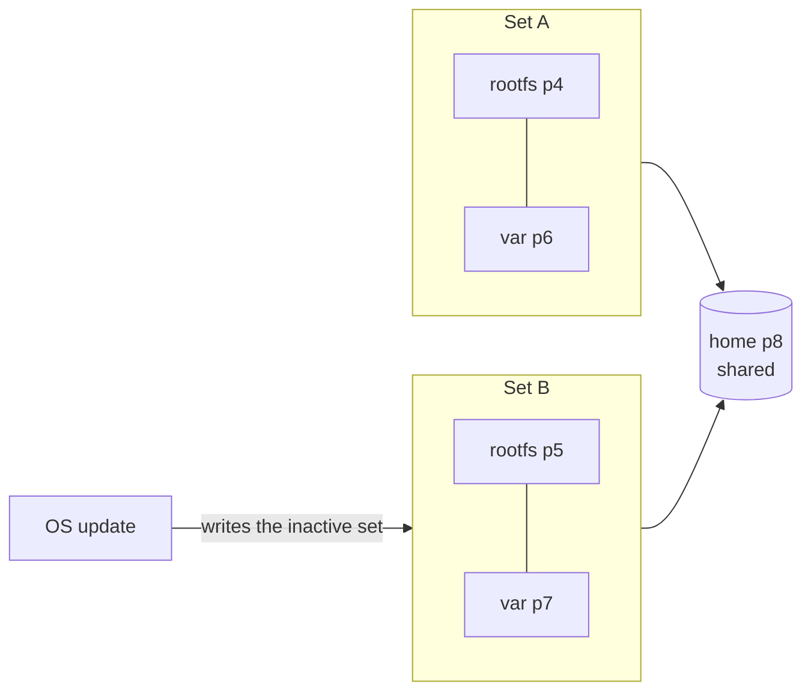

# Système de fichiers

[English](../README.md) | [한국어](README.ko.md) | [日本語](README.ja.md) | [简体中文](README.zh-CN.md) | [Español](README.es.md) | **Français**

  

Ce qu'une mise à jour du système efface et ce qui survit. Tout a été vérifié à la main sur SteamOS 3.8.14 dans VMware, et c'est la raison pour laquelle chaque fichier de ce dépôt est à sa place.

## Sommaire

- [Structure du disque : deux systèmes (A/B) et un home partagé](#structure-du-disque--deux-systèmes-ab-et-un-home-partagé)
- [Est-ce vraiment en lecture seule ?](#est-ce-vraiment-en-lecture-seule-)
- [/etc : seuls les fichiers listés sont conservés](#etc--seuls-les-fichiers-listés-sont-conservés)
- [La base de pacman est aussi en lecture seule](#la-base-de-pacman-est-aussi-en-lecture-seule)
- [Outils préinstallés](#outils-préinstallés)
- [Règles de placement de ce dépôt](#règles-de-placement-de-ce-dépôt)

---

## Structure du disque : deux systèmes (A/B) et un home partagé

| Partition | Taille | Rôle |
| --- | --- | --- |
| `nvme0n1p1` esp | 256M | Chargeur d'amorçage |
| `p2` / `p3` efi | 64M | Entrées de démarrage A / B |
| `p4` / `p5` rootfs | 5G, btrfs | Système A / B (`/`) |
| `p6` / `p7` var | 256M | Journaux et modifications de `/etc` A / B (`/var`) |
| `p8` home | Le reste | Données utilisateur (`/home`), **partagé par A et B** |




Une mise à jour écrit un système neuf complet dans le jeu qui n'est **pas** en cours d'utilisation (démarré sur A → écrit sur B) et bascule dessus au démarrage suivant. Seul `/home` est utilisé par les deux jeux : c'est le seul endroit que les mises à jour ne touchent pas.

## Est-ce vraiment en lecture seule ?


```text
$ steamos-readonly status
enabled
$ sudo touch /usr/test-write
touch: cannot touch '/usr/test-write': Read-only file system
$ touch ~/test-write && echo HOME_OK
HOME_OK
```

## /etc : seuls les fichiers listés sont conservés

Les modifications de `/etc` sont stockées sur la partition var du jeu actif. Quand une mise à jour échange A et B, **seuls les fichiers de la liste de conservation** sont copiés vers le nouveau jeu.

| Liste | Chemin |
| --- | --- |
| Par défaut | `/usr/lib/rauc/atomic-update-keep.conf` |
| Ajouts de l'utilisateur | `/etc/atomic-update.conf.d/*.conf` |


> [!WARNING]
> Le fichier fourni `example-additional-keep-list.conf` avertit qu'un motif large comme `/etc/**` masque toutes les futures modifications de `/etc` apportées par les mises à jour. Listez les fichiers un par un.

C'est pourquoi ce dépôt touche à peine `/etc`, et quand il le fait, le module `60-etc-keep` enregistre exactement ces fichiers.

## La base de pacman est aussi en lecture seule

`pacman-conf DBPath` vaut `/usr/lib/holo/pacmandb/` : même `pacman -Sy` échoue avec `Read-only file system`. Pour seulement télécharger des paquets, copiez la base dans un emplacement inscriptible et pointez `--dbpath` dessus ([T4](../../04-Troubleshooting/README/README.fr.md#t4)).

## Outils préinstallés


| Outil | Version | Usage |
| --- | --- | --- |
| Flatpak | flathub (system), flathub-beta | Applications graphiques |
| distrobox | 1.8.1.2 | Conteneurs d'outils CLI |
| podman | 5.5.2 | Backend de distrobox |

## Règles de placement de ce dépôt

| Emplacement | Après une mise à jour | Usage dans ce dépôt |
| --- | --- | --- |
| `/usr` | Remplacé | Jamais touché |
| `/etc` | Seuls les fichiers listés survivent | Le strict nécessaire + `60-etc-keep` |
| `/home` | Survit | Flatpak `--user`, distrobox, dotfiles, unités utilisateur systemd, journaux |

> [!TIP]
> Règle simple : ce qui n'est ni dans `/home` ni dans la liste de conservation sera supprimé à la prochaine mise à jour.
