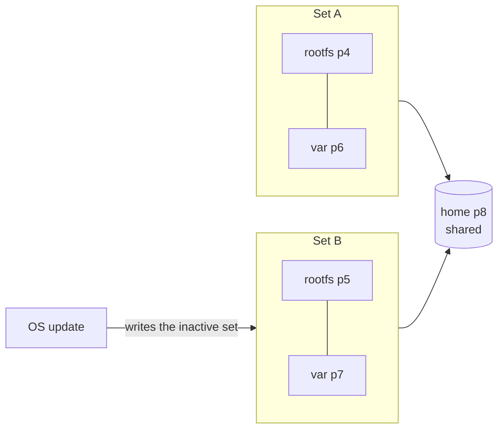
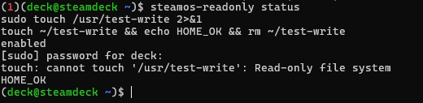

# ファイルシステム

[English](../README.md) | [한국어](README.ko.md) | **日本語** | [简体中文](README.zh-CN.md) | [Español](README.es.md) | [Français](README.fr.md)

  

OS アップデートで何が消え、何が残るのか。すべて VMware 上の SteamOS 3.8.14 で手作業で確認した内容で、このリポジトリの各ファイルが今の場所にある理由でもあります。

## 目次

- [ディスク構成: 2 組のシステム（A/B）と共有の home](#ディスク構成-2-組のシステムabと共有の-home)
- [本当に読み取り専用か](#本当に読み取り専用か)
- [/etc: 一覧にあるファイルだけが引き継がれる](#etc-一覧にあるファイルだけが引き継がれる)
- [pacman のデータベースも読み取り専用](#pacman-のデータベースも読み取り専用)
- [標準搭載のツール](#標準搭載のツール)
- [このリポジトリの配置ルール](#このリポジトリの配置ルール)

---

## ディスク構成: 2 組のシステム（A/B）と共有の home

| パーティション | サイズ | 役割 |
| --- | --- | --- |
| `nvme0n1p1` esp | 256M | ブートローダー |
| `p2` / `p3` efi | 64M | ブートエントリー A / B |
| `p4` / `p5` rootfs | 5G、btrfs | システム A / B（`/`） |
| `p6` / `p7` var | 256M | ログと `/etc` の変更分 A / B（`/var`） |
| `p8` home | 残り全部 | ユーザーデータ（`/home`）、**A と B で共有** |




アップデートは、実行中 **ではない** 側（A で起動中なら B）に新しいシステムを丸ごと書き込み、次回起動時にそちらへ切り替えます。`/home` だけが両方で使われるため、アップデートの影響を受けない唯一の場所です。

## 本当に読み取り専用か



```text
$ steamos-readonly status
enabled
$ sudo touch /usr/test-write
touch: cannot touch '/usr/test-write': Read-only file system
$ touch ~/test-write && echo HOME_OK
HOME_OK
```

## /etc: 一覧にあるファイルだけが引き継がれる

`/etc` の変更は、使用中の側の var パーティションに保存されます。アップデートで A と B が入れ替わるとき、**保持リストにあるファイルだけ** が新しい側にコピーされます。

| リスト | パス |
| --- | --- |
| 既定 | `/usr/lib/rauc/atomic-update-keep.conf` |
| ユーザー追加 | `/etc/atomic-update.conf.d/*.conf` |


> [!WARNING]
> 同梱の `example-additional-keep-list.conf` は、`/etc/**` のような広いパターンを使うと、以後のアップデートで届く `/etc` の変更をすべて隠してしまうと警告しています。項目はファイル単位で指定してください。

そのため、このリポジトリは `/etc` をほとんど使わず、使う場合は `60-etc-keep` モジュールでそのファイルだけをリストに登録します。

## pacman のデータベースも読み取り専用

`pacman-conf DBPath` は `/usr/lib/holo/pacmandb/` なので、`pacman -Sy` でさえ `Read-only file system` で失敗します。パッケージをダウンロードするだけなら、データベースを書き込み可能な場所にコピーして `--dbpath` で指定します（[T4](../../04-Troubleshooting/README/README.ja.md#t4)）。

## 標準搭載のツール


| ツール | バージョン | 用途 |
| --- | --- | --- |
| Flatpak | flathub（system）、flathub-beta | GUI アプリ |
| distrobox | 1.8.1.2 | CLI ツールのコンテナ |
| podman | 5.5.2 | distrobox のバックエンド |

## このリポジトリの配置ルール

| 場所 | アップデート後 | このリポジトリでの使い方 |
| --- | --- | --- |
| `/usr` | 置き換えられる | 触らない |
| `/etc` | 保持リストのファイルだけ残る | 必要最小限 + `60-etc-keep` |
| `/home` | 残る | Flatpak `--user`、distrobox、dotfiles、systemd ユーザーユニット、ログ |

> [!TIP]
> 目安: `/home` にも保持リストにもないものは、次のアップデートで消えると考えてください。
