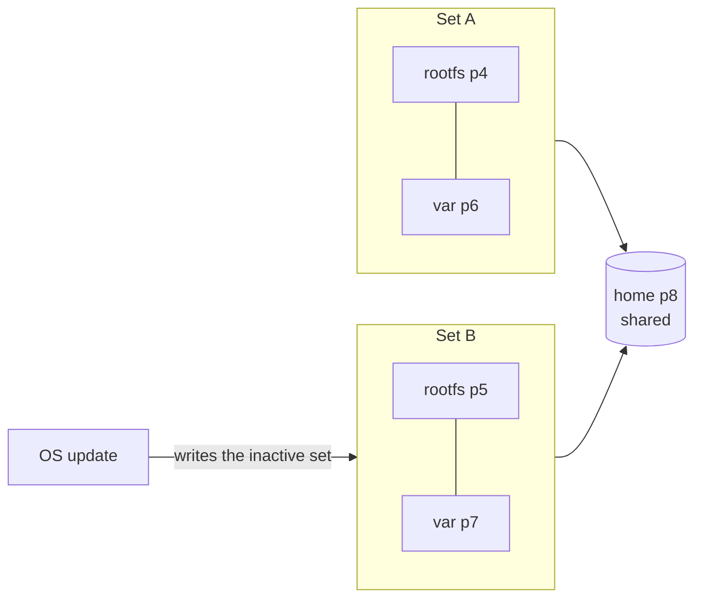
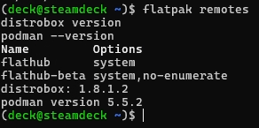

# 파일 시스템

[English](../README.md) | **한국어** | [日本語](README.ja.md) | [简体中文](README.zh-CN.md) | [Español](README.es.md) | [Français](README.fr.md)

  

OS 업데이트 때 무엇이 사라지고 무엇이 남는지 정리합니다. 모두 VMware의 SteamOS 3.8.14에서 직접 확인했으며, 이 저장소의 모든 파일이 지금 위치에 있는 이유이기도 합니다.

## 목차

- [디스크 구조: 시스템 두 벌(A/B)과 공용 home](#디스크-구조-시스템-두-벌ab과-공용-home)
- [정말 읽기 전용인지](#정말-읽기-전용인지)
- [/etc: 목록에 있는 파일만 넘어감](#etc-목록에-있는-파일만-넘어감)
- [pacman 데이터베이스도 읽기 전용](#pacman-데이터베이스도-읽기-전용)
- [기본 설치 도구](#기본-설치-도구)
- [이 저장소의 배치 원칙](#이-저장소의-배치-원칙)

---

## 디스크 구조: 시스템 두 벌(A/B)과 공용 home

| 파티션 | 크기 | 역할 |
| --- | --- | --- |
| `nvme0n1p1` esp | 256M | 부트로더 |
| `p2` / `p3` efi | 64M | 부팅 항목 A / B |
| `p4` / `p5` rootfs | 5G, btrfs | 시스템 A / B (`/`) |
| `p6` / `p7` var | 256M | 기록과 `/etc` 변경분 A / B (`/var`) |
| `p8` home | 나머지 전부 | 사용자 데이터 (`/home`), **A/B 공용** |




업데이트는 지금 실행 중이 **아닌** 쪽(A로 부팅 중이면 B)에 새 시스템을 통째로 쓰고, 다음 부팅부터 그쪽으로 넘어갑니다. `/home` 만 양쪽이 함께 쓰므로 업데이트와 무관하게 남는 유일한 곳입니다.

## 정말 읽기 전용인지


```text
$ steamos-readonly status
enabled
$ sudo touch /usr/test-write
touch: cannot touch '/usr/test-write': Read-only file system
$ touch ~/test-write && echo HOME_OK
HOME_OK
```

## /etc: 목록에 있는 파일만 넘어감

`/etc` 변경분은 지금 쓰는 쪽의 var 파티션에 저장됩니다. 업데이트로 A/B가 바뀔 때는 **유지 목록에 있는 파일만** 새 쪽으로 복사됩니다.

| 목록 | 경로 |
| --- | --- |
| 기본 | `/usr/lib/rauc/atomic-update-keep.conf` |
| 사용자 추가 | `/etc/atomic-update.conf.d/*.conf` |


> [!WARNING]
> 함께 들어 있는 `example-additional-keep-list.conf` 는 `/etc/**` 처럼 넓게 잡으면 이후 업데이트가 가져오는 `/etc` 변경을 모두 가린다고 경고합니다. 항목은 파일 단위로 지정하세요.

그래서 이 저장소는 `/etc` 를 거의 쓰지 않고, 쓸 때는 `60-etc-keep` 모듈로 해당 파일만 목록에 등록합니다.

## pacman 데이터베이스도 읽기 전용

`pacman-conf DBPath` 는 `/usr/lib/holo/pacmandb/` 이므로 `pacman -Sy` 조차 `Read-only file system` 으로 실패합니다. 패키지를 받기만 하려면 데이터베이스를 쓰기 가능한 곳에 복사하고 `--dbpath` 로 지정합니다([T4](../../04-Troubleshooting/README/README.ko.md#t4)).

## 기본 설치 도구



| 도구 | 버전 | 쓰임 |
| --- | --- | --- |
| Flatpak | flathub(system), flathub-beta | GUI 앱 |
| distrobox | 1.8.1.2 | CLI 도구 컨테이너 |
| podman | 5.5.2 | distrobox 백엔드 |

## 이 저장소의 배치 원칙

| 위치 | 업데이트 후 | 이 저장소의 사용 방법 |
| --- | --- | --- |
| `/usr` | 교체됨 | 건드리지 않음 |
| `/etc` | 유지 목록의 파일만 남음 | 꼭 필요한 것만 + `60-etc-keep` |
| `/home` | 남음 | Flatpak `--user`, distrobox, dotfiles, systemd 사용자 유닛, 로그 |

> [!TIP]
> 한 줄 원칙: `/home` 에 있지 않거나 유지 목록에 없다면, 다음 업데이트에서 지워진다고 생각하세요.
