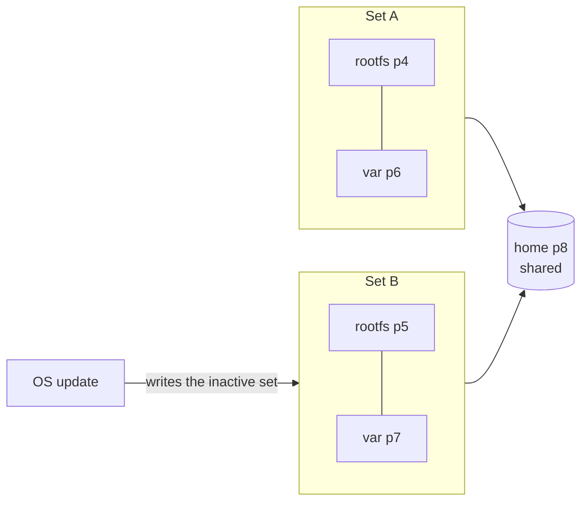

# 文件系统

[English](../README.md) | [한국어](README.ko.md) | [日本語](README.ja.md) | **简体中文** | [Español](README.es.md) | [Français](README.fr.md)

  

系统更新会清除什么、保留什么。以下内容均在 VMware 中的 SteamOS 3.8.14 上手动验证，这也是本仓库中每个文件放在现有位置的原因。

## 目录

- [磁盘布局：两套系统（A/B）与共享的 home](#磁盘布局两套系统ab与共享的-home)
- [真的是只读吗](#真的是只读吗)
- [/etc：只有列表中的文件会被保留](#etc只有列表中的文件会被保留)
- [pacman 数据库同样只读](#pacman-数据库同样只读)
- [预装工具](#预装工具)
- [本仓库的放置原则](#本仓库的放置原则)

---

## 磁盘布局：两套系统（A/B）与共享的 home

| 分区 | 大小 | 作用 |
| --- | --- | --- |
| `nvme0n1p1` esp | 256M | 引导程序 |
| `p2` / `p3` efi | 64M | 启动项 A / B |
| `p4` / `p5` rootfs | 5G，btrfs | 系统 A / B（`/`） |
| `p6` / `p7` var | 256M | 日志与 `/etc` 改动 A / B（`/var`） |
| `p8` home | 其余全部 | 用户数据（`/home`），**A 与 B 共享** |




更新会把完整的新系统写入 **未在运行** 的一组（从 A 启动则写入 B），并在下次启动时切换过去。只有 `/home` 被两组共同使用，因此它是唯一不受更新影响的地方。

## 真的是只读吗


```text
$ steamos-readonly status
enabled
$ sudo touch /usr/test-write
touch: cannot touch '/usr/test-write': Read-only file system
$ touch ~/test-write && echo HOME_OK
HOME_OK
```

## /etc：只有列表中的文件会被保留

`/etc` 的改动保存在当前使用组的 var 分区中。更新切换 A 和 B 时，**只有保留列表中的文件** 会被复制到新的一组。

| 列表 | 路径 |
| --- | --- |
| 默认 | `/usr/lib/rauc/atomic-update-keep.conf` |
| 用户追加 | `/etc/atomic-update.conf.d/*.conf` |


> [!WARNING]
> 自带的 `example-additional-keep-list.conf` 警告：使用 `/etc/**` 这类宽泛的模式，会屏蔽之后所有更新带来的 `/etc` 改动。请按文件逐项指定。

因此本仓库几乎不使用 `/etc`；确需使用时，由 `60-etc-keep` 模块只把相关文件登记到列表中。

## pacman 数据库同样只读

`pacman-conf DBPath` 是 `/usr/lib/holo/pacmandb/`，所以连 `pacman -Sy` 都会因 `Read-only file system` 失败。如果只需下载软件包，把数据库复制到可写位置并用 `--dbpath` 指定（[T4](../../04-Troubleshooting/README/README.zh-CN.md#t4)）。

## 预装工具


| 工具 | 版本 | 用途 |
| --- | --- | --- |
| Flatpak | flathub（system）、flathub-beta | 图形界面应用 |
| distrobox | 1.8.1.2 | 命令行工具容器 |
| podman | 5.5.2 | distrobox 后端 |

## 本仓库的放置原则

| 位置 | 更新之后 | 本仓库的用法 |
| --- | --- | --- |
| `/usr` | 被替换 | 从不修改 |
| `/etc` | 只保留列表中的文件 | 仅限必要内容 + `60-etc-keep` |
| `/home` | 保留 | Flatpak `--user`、distrobox、dotfiles、systemd 用户单元、日志 |

> [!TIP]
> 经验法则：不在 `/home` 中也不在保留列表里的东西，就当作下次更新会被删除。
