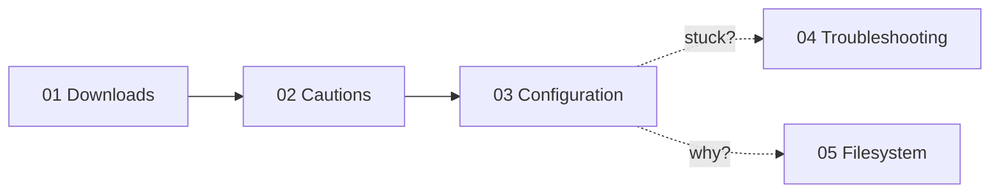

# Documentation

**English** | [한국어](README/README.ko.md) | [日本語](README/README.ja.md) | [简体中文](README/README.zh-CN.md) | [Español](README/README.es.md) | [Français](README/README.fr.md)

  

Everything behind SteamOS-Unattended: what to download, what to watch out for, how the VMware test machine was built, what broke along the way and how SteamOS stores files.

## Contents

- [Sections](#sections)
- [Reading order](#reading-order)

---

## Sections

| # | Section | Contents |
| --- | --- | --- |
| 01 | [Downloads](01-Downloads/README.md) | Required files, official download links, tested versions |
| 02 | [Cautions](02-Cautions/README.md) | What to know before running anything |
| 03 | [Configuration](03-Configuration/README.md) | Six steps from an empty VM to a verified run |
| 04 | [Troubleshooting](04-Troubleshooting/README.md) | 15 real problems with cause and fix |
| 05 | [Filesystem](05-Filesystem/README.md) | What an OS update wipes and what survives |

## Reading order

| You are… | Start here |
| --- | --- |
| A Steam Deck user who just wants the setup | [Configuration · Step 6](03-Configuration/06-Run-Unattended/README.md) |
| Rebuilding the VMware test environment | [Downloads](01-Downloads/README.md) → [Configuration](03-Configuration/README.md) |
| Curious why files go where they go | [Filesystem](05-Filesystem/README.md) |

> [!NOTE]
> Each document is available in six languages. Use the language bar at the top of any page to switch.
