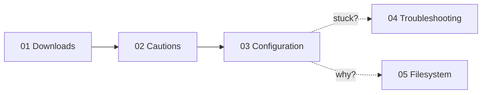

# Documentación

[English](../README.md) | [한국어](README.ko.md) | [日本語](README.ja.md) | [简体中文](README.zh-CN.md) | **Español** | [Français](README.fr.md)

  

Todo lo que hay detrás de SteamOS-Unattended: qué descargar, qué tener en cuenta, cómo se construyó la máquina de prueba en VMware, qué falló por el camino y cómo guarda SteamOS los archivos.

## Índice

- [Secciones](#secciones)
- [Orden de lectura](#orden-de-lectura)

---

## Secciones

| # | Sección | Contenido |
| --- | --- | --- |
| 01 | [Descargas](../01-Downloads/README/README.es.md) | Archivos necesarios, enlaces oficiales, versiones probadas |
| 02 | [Precauciones](../02-Cautions/README/README.es.md) | Lo que conviene saber antes de ejecutar nada |
| 03 | [Configuración](../03-Configuration/README/README.es.md) | Seis pasos de una VM vacía a una ejecución verificada |
| 04 | [Solución de problemas](../04-Troubleshooting/README/README.es.md) | 15 problemas reales con causa y solución |
| 05 | [Sistema de archivos](../05-Filesystem/README/README.es.md) | Qué borra una actualización y qué sobrevive |

## Orden de lectura

| Si eres… | Empieza aquí |
| --- | --- |
| Usuario de Steam Deck que solo quiere la configuración | [Configuración · Paso 6](../03-Configuration/06-Run-Unattended/README/README.es.md) |
| Quien reconstruye el entorno de prueba en VMware | [Descargas](../01-Downloads/README/README.es.md) → [Configuración](../03-Configuration/README/README.es.md) |
| Curioso por saber por qué cada archivo está donde está | [Sistema de archivos](../05-Filesystem/README/README.es.md) |

> [!NOTE]
> Cada documento está disponible en seis idiomas. Usa la barra de idiomas en la parte superior de cualquier página para cambiar.
