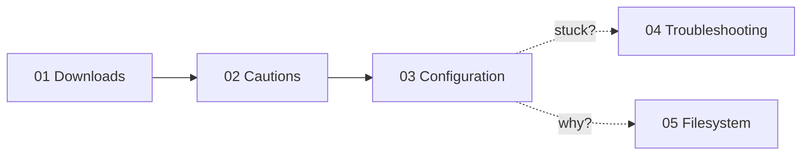

# Documentation

[English](../README.md) | [한국어](README.ko.md) | [日本語](README.ja.md) | [简体中文](README.zh-CN.md) | [Español](README.es.md) | **Français**

  

Tout ce qui se trouve derrière SteamOS-Unattended : quoi télécharger, à quoi faire attention, comment la machine de test VMware a été construite, ce qui a cassé en chemin et comment SteamOS conserve les fichiers.

## Sommaire

- [Sections](#sections)
- [Ordre de lecture](#ordre-de-lecture)

---

## Sections

| # | Section | Contenu |
| --- | --- | --- |
| 01 | [Téléchargements](../01-Downloads/README/README.fr.md) | Fichiers nécessaires, liens officiels, versions testées |
| 02 | [Précautions](../02-Cautions/README/README.fr.md) | Ce qu'il faut savoir avant de lancer quoi que ce soit |
| 03 | [Configuration](../03-Configuration/README/README.fr.md) | Six étapes d'une VM vide à une exécution vérifiée |
| 04 | [Dépannage](../04-Troubleshooting/README/README.fr.md) | 15 problèmes réels avec cause et solution |
| 05 | [Système de fichiers](../05-Filesystem/README/README.fr.md) | Ce qu'une mise à jour efface et ce qui survit |

## Ordre de lecture

| Vous êtes… | Commencez ici |
| --- | --- |
| Utilisateur de Steam Deck qui veut juste la configuration | [Configuration · Étape 6](../03-Configuration/06-Run-Unattended/README/README.fr.md) |
| En train de reconstruire l'environnement de test VMware | [Téléchargements](../01-Downloads/README/README.fr.md) → [Configuration](../03-Configuration/README/README.fr.md) |
| Curieux de savoir pourquoi chaque fichier est à sa place | [Système de fichiers](../05-Filesystem/README/README.fr.md) |

> [!NOTE]
> Chaque document existe en six langues. Utilisez la barre de langues en haut de chaque page pour changer.
