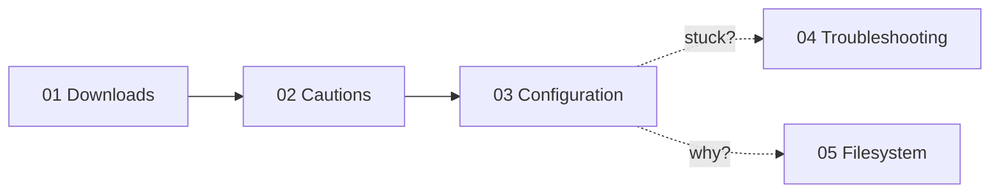

# ドキュメント

[English](../README.md) | [한국어](README.ko.md) | **日本語** | [简体中文](README.zh-CN.md) | [Español](README.es.md) | [Français](README.fr.md)

  

SteamOS-Unattended の背景のすべて: 何をダウンロードするか、何に注意するか、VMware のテストマシンをどう作ったか、途中で何が起きたか、そして SteamOS がファイルをどう保持するか。

## 目次

- [構成](#構成)
- [読む順番](#読む順番)

---

## 構成

| # | ドキュメント | 内容 |
| --- | --- | --- |
| 01 | [ダウンロード](../01-Downloads/README/README.ja.md) | 必要なファイル、公式ダウンロードリンク、検証済みバージョン |
| 02 | [注意事項](../02-Cautions/README/README.ja.md) | 実行前に知っておくこと |
| 03 | [構成](../03-Configuration/README/README.ja.md) | 空の VM から検証済みの実行までの 6 ステップ |
| 04 | [トラブルシューティング](../04-Troubleshooting/README/README.ja.md) | 実際に起きた 15 の問題と原因・対処 |
| 05 | [ファイルシステム](../05-Filesystem/README/README.ja.md) | OS アップデートで消えるもの、残るもの |

## 読む順番

| こんな方は | ここから |
| --- | --- |
| セットアップだけしたい Steam Deck ユーザー | [構成 · ステップ 6](../03-Configuration/06-Run-Unattended/README/README.ja.md) |
| VMware のテスト環境を作り直したい方 | [ダウンロード](../01-Downloads/README/README.ja.md) → [構成](../03-Configuration/README/README.ja.md) |
| ファイルの置き場所の理由を知りたい方 | [ファイルシステム](../05-Filesystem/README/README.ja.md) |

> [!NOTE]
> 各ドキュメントは 6 言語で用意しています。ページ上部の言語バーで切り替えられます。
