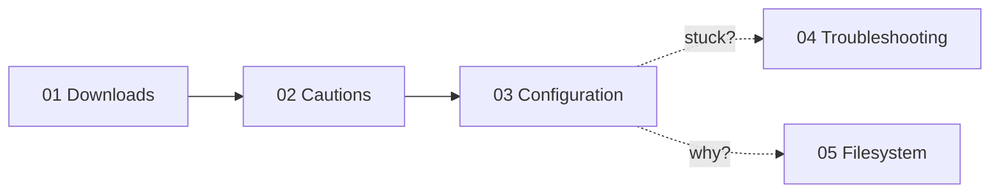

# 문서

[English](../README.md) | **한국어** | [日本語](README.ja.md) | [简体中文](README.zh-CN.md) | [Español](README.es.md) | [Français](README.fr.md)

  

SteamOS-Unattended의 뒷이야기를 모두 담았습니다. 무엇을 받아야 하는지, 무엇을 조심해야 하는지, VMware 테스트 머신을 어떻게 만들었는지, 진행 중 무엇이 막혔는지, SteamOS가 파일을 어떻게 보관하는지 정리했습니다.

## 목차

- [구성](#구성)
- [읽는 순서](#읽는-순서)

---

## 구성

| # | 문서 | 내용 |
| --- | --- | --- |
| 01 | [자료실](../01-Downloads/README/README.ko.md) | 필요한 파일, 공식 다운로드 링크, 검증 버전 |
| 02 | [주의사항](../02-Cautions/README/README.ko.md) | 실행 전에 알아 둘 것 |
| 03 | [구성](../03-Configuration/README/README.ko.md) | 빈 VM에서 검증된 실행까지 6단계 |
| 04 | [트러블슈팅](../04-Troubleshooting/README/README.ko.md) | 실제로 겪은 문제 15가지의 원인과 해결 |
| 05 | [파일 시스템](../05-Filesystem/README/README.ko.md) | OS 업데이트 때 무엇이 사라지고 무엇이 남는지 |

## 읽는 순서

| 이런 분이라면 | 여기서 시작 |
| --- | --- |
| 세팅만 하고 싶은 Steam Deck 사용자 | [구성 · 6단계](../03-Configuration/06-Run-Unattended/README/README.ko.md) |
| VMware 테스트 환경을 다시 만들려는 분 | [자료실](../01-Downloads/README/README.ko.md) → [구성](../03-Configuration/README/README.ko.md) |
| 파일이 왜 그 위치에 있는지 궁금한 분 | [파일 시스템](../05-Filesystem/README/README.ko.md) |

> [!NOTE]
> 모든 문서는 6개 언어로 제공됩니다. 각 페이지 맨 위의 언어 바에서 바꿀 수 있습니다.
