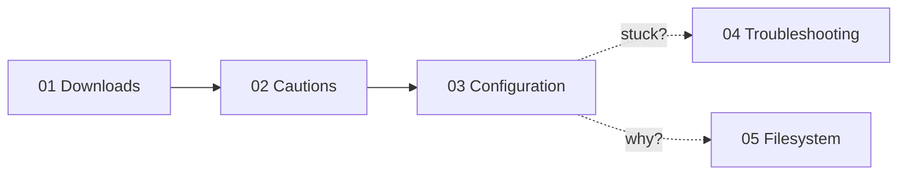

# 文档

[English](../README.md) | [한국어](README.ko.md) | [日本語](README.ja.md) | **简体中文** | [Español](README.es.md) | [Français](README.fr.md)

  

SteamOS-Unattended 背后的全部内容：需要下载什么、需要注意什么、VMware 测试机是如何搭建的、过程中遇到了哪些问题，以及 SteamOS 如何保存文件。

## 目录

- [组成](#组成)
- [阅读顺序](#阅读顺序)

---

## 组成

| # | 文档 | 内容 |
| --- | --- | --- |
| 01 | [下载](../01-Downloads/README/README.zh-CN.md) | 所需文件、官方下载链接、已验证版本 |
| 02 | [注意事项](../02-Cautions/README/README.zh-CN.md) | 运行前需要了解的内容 |
| 03 | [配置](../03-Configuration/README/README.zh-CN.md) | 从空虚拟机到验证通过的 6 个步骤 |
| 04 | [故障排除](../04-Troubleshooting/README/README.zh-CN.md) | 15 个真实问题及其原因与解决方法 |
| 05 | [文件系统](../05-Filesystem/README/README.zh-CN.md) | 系统更新会清除什么、保留什么 |

## 阅读顺序

| 如果你是… | 从这里开始 |
| --- | --- |
| 只想完成配置的 Steam Deck 用户 | [配置 · 第 6 步](../03-Configuration/06-Run-Unattended/README/README.zh-CN.md) |
| 想重建 VMware 测试环境 | [下载](../01-Downloads/README/README.zh-CN.md) → [配置](../03-Configuration/README/README.zh-CN.md) |
| 想知道文件为何放在那里 | [文件系统](../05-Filesystem/README/README.zh-CN.md) |

> [!NOTE]
> 每篇文档都提供 6 种语言。可以用页面顶部的语言栏切换。
