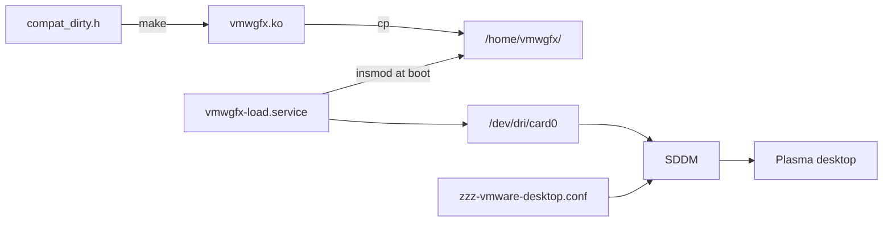

# vmware/

**English** | [한국어](README/README.ko.md) | [日本語](README/README.ja.md) | [简体中文](README/README.zh-CN.md) | [Español](README/README.es.md) | [Français](README/README.fr.md)

 

Files used to bring up SteamOS Desktop Mode in the VMware test environment.

> [!IMPORTANT]
> **Not needed on a real Steam Deck.** `install.sh` never touches this folder.

## Contents

- [Files](#files)
- [How they fit together](#how-they-fit-together)

---

## Files

| File | Installed to | Purpose | Guide |
| --- | --- | --- | --- |
| [`compat_dirty.h`](compat_dirty.h) | vmwgfx source folder | Replacement for two kernel functions missing from the Valve kernel | [Step 3](../docs/03-Configuration/03-vmwgfx-Driver/README.md#compat-patch) |
| [`vmwgfx-load.service`](vmwgfx-load.service) | `/etc/systemd/system/` (sets A and B) | Loads `/home/vmwgfx/vmwgfx.ko` before the display manager | [Step 5](../docs/03-Configuration/05-Desktop-Autostart/README.md) |
| [`zzz-vmware-desktop.conf`](zzz-vmware-desktop.conf) | `/etc/sddm.conf.d/` (sets A and B) | Autologin to Desktop Mode (`plasma.desktop`) | [Step 5](../docs/03-Configuration/05-Desktop-Autostart/README.md) |

## How they fit together

> [!NOTE]
> The built `vmwgfx.ko` is tied to one kernel version, so it is not committed (`.gitignore`). Rebuild it after every SteamOS kernel update ([Step 3](../docs/03-Configuration/03-vmwgfx-Driver/README.md)).
