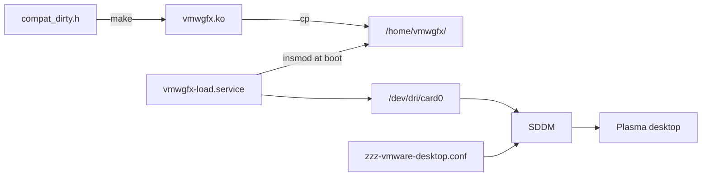

# vmware/

[English](../README.md) | [한국어](README.ko.md) | [日本語](README.ja.md) | [简体中文](README.zh-CN.md) | **Español** | [Français](README.fr.md)

 

Archivos usados para arrancar el modo escritorio de SteamOS en el entorno de prueba de VMware.

> [!IMPORTANT]
> **No hacen falta en una Steam Deck real.** `install.sh` nunca toca esta carpeta.

## Índice

- [Archivos](#archivos)
- [Cómo encajan](#cómo-encajan)

---

## Archivos

| Archivo | Se instala en | Función | Guía |
| --- | --- | --- | --- |
| [`compat_dirty.h`](../compat_dirty.h) | Carpeta de código de vmwgfx | Sustituye dos funciones del kernel que faltan en el kernel de Valve | [Paso 3](../../docs/03-Configuration/03-vmwgfx-Driver/README/README.es.md#compat-patch) |
| [`vmwgfx-load.service`](../vmwgfx-load.service) | `/etc/systemd/system/` (conjuntos A y B) | Carga `/home/vmwgfx/vmwgfx.ko` antes del gestor de pantalla | [Paso 5](../../docs/03-Configuration/05-Desktop-Autostart/README/README.es.md) |
| [`zzz-vmware-desktop.conf`](../zzz-vmware-desktop.conf) | `/etc/sddm.conf.d/` (conjuntos A y B) | Inicio automático en el modo escritorio (`plasma.desktop`) | [Paso 5](../../docs/03-Configuration/05-Desktop-Autostart/README/README.es.md) |

## Cómo encajan

> [!NOTE]
> El `vmwgfx.ko` compilado depende de una versión concreta del kernel, así que no se incluye en el repositorio (`.gitignore`). Recompílalo tras cada actualización del kernel de SteamOS ([Paso 3](../../docs/03-Configuration/03-vmwgfx-Driver/README/README.es.md)).
