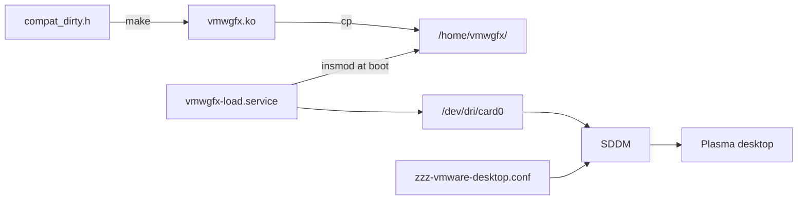

# vmware/

[English](../README.md) | [한국어](README.ko.md) | [日本語](README.ja.md) | [简体中文](README.zh-CN.md) | [Español](README.es.md) | **Français**

 

Fichiers utilisés pour démarrer le mode bureau de SteamOS dans l'environnement de test VMware.

> [!IMPORTANT]
> **Inutiles sur un vrai Steam Deck.** `install.sh` ne touche jamais à ce dossier.

## Sommaire

- [Fichiers](#fichiers)
- [Comment ils s'articulent](#comment-ils-sarticulent)

---

## Fichiers

| Fichier | Installé dans | Rôle | Guide |
| --- | --- | --- | --- |
| [`compat_dirty.h`](../compat_dirty.h) | Dossier source de vmwgfx | Remplace deux fonctions du noyau absentes du noyau Valve | [Étape 3](../../docs/03-Configuration/03-vmwgfx-Driver/README/README.fr.md#compat-patch) |
| [`vmwgfx-load.service`](../vmwgfx-load.service) | `/etc/systemd/system/` (jeux A et B) | Charge `/home/vmwgfx/vmwgfx.ko` avant le gestionnaire d'affichage | [Étape 5](../../docs/03-Configuration/05-Desktop-Autostart/README/README.fr.md) |
| [`zzz-vmware-desktop.conf`](../zzz-vmware-desktop.conf) | `/etc/sddm.conf.d/` (jeux A et B) | Connexion automatique en mode bureau (`plasma.desktop`) | [Étape 5](../../docs/03-Configuration/05-Desktop-Autostart/README/README.fr.md) |

## Comment ils s'articulent

> [!NOTE]
> Le `vmwgfx.ko` compilé dépend d'une version précise du noyau ; il n'est donc pas versionné (`.gitignore`). Recompilez-le après chaque mise à jour du noyau SteamOS ([Étape 3](../../docs/03-Configuration/03-vmwgfx-Driver/README/README.fr.md)).
