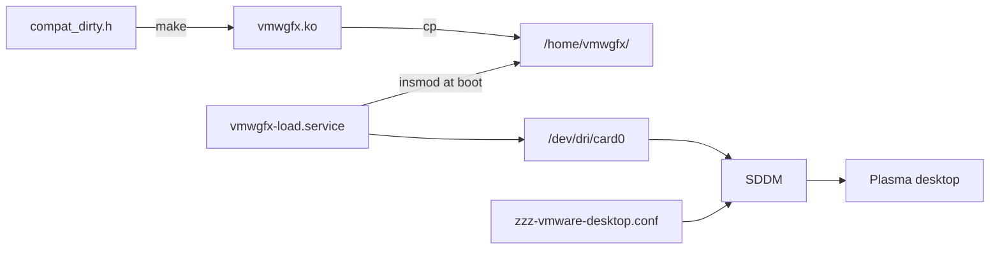

# vmware/

[English](../README.md) | [한국어](README.ko.md) | **日本語** | [简体中文](README.zh-CN.md) | [Español](README.es.md) | [Français](README.fr.md)

 

VMware のテスト環境で SteamOS のデスクトップモードを起動するために使ったファイルです。

> [!IMPORTANT]
> **実機の Steam Deck には不要です。** `install.sh` はこのフォルダーに触れません。

## 目次

- [ファイル](#ファイル)
- [連携の仕組み](#連携の仕組み)

---

## ファイル

| ファイル | 配置先 | 役割 | 手順 |
| --- | --- | --- | --- |
| [`compat_dirty.h`](../compat_dirty.h) | vmwgfx のソースフォルダー | Valve カーネルにない 2 つのカーネル関数の代替実装 | [ステップ 3](../../docs/03-Configuration/03-vmwgfx-Driver/README/README.ja.md#compat-patch) |
| [`vmwgfx-load.service`](../vmwgfx-load.service) | `/etc/systemd/system/`（A と B の両方） | ディスプレイマネージャーより先に `/home/vmwgfx/vmwgfx.ko` を読み込む | [ステップ 5](../../docs/03-Configuration/05-Desktop-Autostart/README/README.ja.md) |
| [`zzz-vmware-desktop.conf`](../zzz-vmware-desktop.conf) | `/etc/sddm.conf.d/`（A と B の両方） | デスクトップモード（`plasma.desktop`）に自動ログイン | [ステップ 5](../../docs/03-Configuration/05-Desktop-Autostart/README/README.ja.md) |

## 連携の仕組み

> [!NOTE]
> ビルドした `vmwgfx.ko` は特定のカーネルバージョンに依存するため、リポジトリには含めません（`.gitignore`）。SteamOS のカーネル更新のたびに再ビルドしてください（[ステップ 3](../../docs/03-Configuration/03-vmwgfx-Driver/README/README.ja.md)）。
