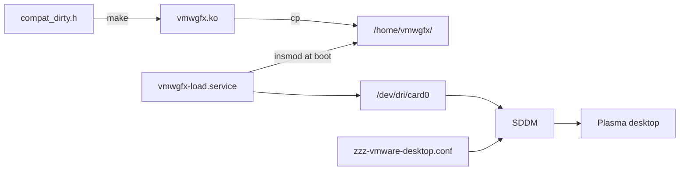

# vmware/

[English](../README.md) | **한국어** | [日本語](README.ja.md) | [简体中文](README.zh-CN.md) | [Español](README.es.md) | [Français](README.fr.md)

 

VMware 테스트 환경에서 SteamOS 데스크톱 모드를 띄우는 데 쓴 파일입니다.

> [!IMPORTANT]
> **실제 Steam Deck에는 필요 없습니다.** `install.sh` 는 이 폴더를 건드리지 않습니다.

## 목차

- [파일](#파일)
- [동작 관계](#동작-관계)

---

## 파일

| 파일 | 넣는 곳 | 역할 | 안내 |
| --- | --- | --- | --- |
| [`compat_dirty.h`](../compat_dirty.h) | vmwgfx 소스 폴더 | Valve 커널에 없는 커널 함수 2개의 대체 구현 | [3단계](../../docs/03-Configuration/03-vmwgfx-Driver/README/README.ko.md#compat-patch) |
| [`vmwgfx-load.service`](../vmwgfx-load.service) | `/etc/systemd/system/` (A, B 양쪽) | 화면 관리자보다 먼저 `/home/vmwgfx/vmwgfx.ko` 로드 | [5단계](../../docs/03-Configuration/05-Desktop-Autostart/README/README.ko.md) |
| [`zzz-vmware-desktop.conf`](../zzz-vmware-desktop.conf) | `/etc/sddm.conf.d/` (A, B 양쪽) | 데스크톱 모드(`plasma.desktop`)로 자동 로그인 | [5단계](../../docs/03-Configuration/05-Desktop-Autostart/README/README.ko.md) |

## 동작 관계

> [!NOTE]
> 빌드한 `vmwgfx.ko` 는 특정 커널 버전에 묶여 있어 저장소에 넣지 않습니다(`.gitignore`). SteamOS 커널이 업데이트될 때마다 다시 빌드하세요([3단계](../../docs/03-Configuration/03-vmwgfx-Driver/README/README.ko.md)).
