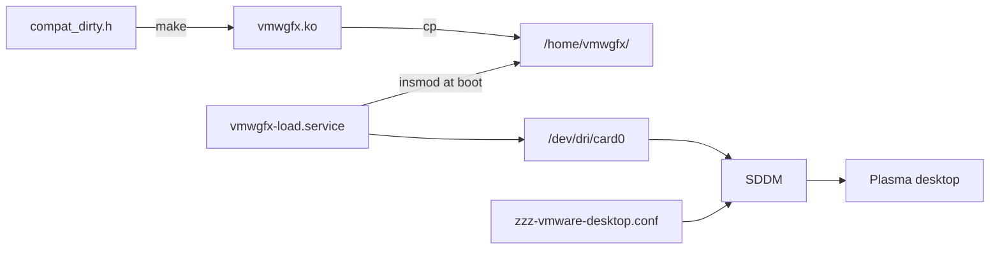

# vmware/

[English](../README.md) | [한국어](README.ko.md) | [日本語](README.ja.md) | **简体中文** | [Español](README.es.md) | [Français](README.fr.md)

 

在 VMware 测试环境中启动 SteamOS 桌面模式所用的文件。

> [!IMPORTANT]
> **真实的 Steam Deck 不需要这些文件。** `install.sh` 不会触碰此文件夹。

## 目录

- [文件](#文件)
- [相互关系](#相互关系)

---

## 文件

| 文件 | 安装位置 | 作用 | 指南 |
| --- | --- | --- | --- |
| [`compat_dirty.h`](../compat_dirty.h) | vmwgfx 源码文件夹 | Valve 内核中缺失的两个内核函数的替代实现 | [第 3 步](../../docs/03-Configuration/03-vmwgfx-Driver/README/README.zh-CN.md#compat-patch) |
| [`vmwgfx-load.service`](../vmwgfx-load.service) | `/etc/systemd/system/`（A、B 两组） | 在显示管理器之前加载 `/home/vmwgfx/vmwgfx.ko` | [第 5 步](../../docs/03-Configuration/05-Desktop-Autostart/README/README.zh-CN.md) |
| [`zzz-vmware-desktop.conf`](../zzz-vmware-desktop.conf) | `/etc/sddm.conf.d/`（A、B 两组） | 自动登录桌面模式（`plasma.desktop`） | [第 5 步](../../docs/03-Configuration/05-Desktop-Autostart/README/README.zh-CN.md) |

## 相互关系

> [!NOTE]
> 构建出的 `vmwgfx.ko` 绑定特定内核版本，因此不提交到仓库（`.gitignore`）。每次 SteamOS 内核更新后都要重新构建（[第 3 步](../../docs/03-Configuration/03-vmwgfx-Driver/README/README.zh-CN.md)）。
